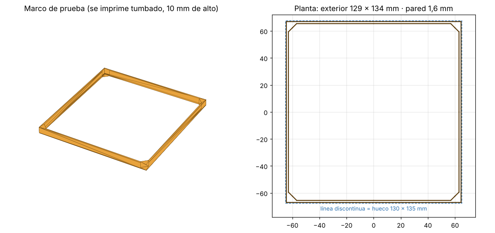
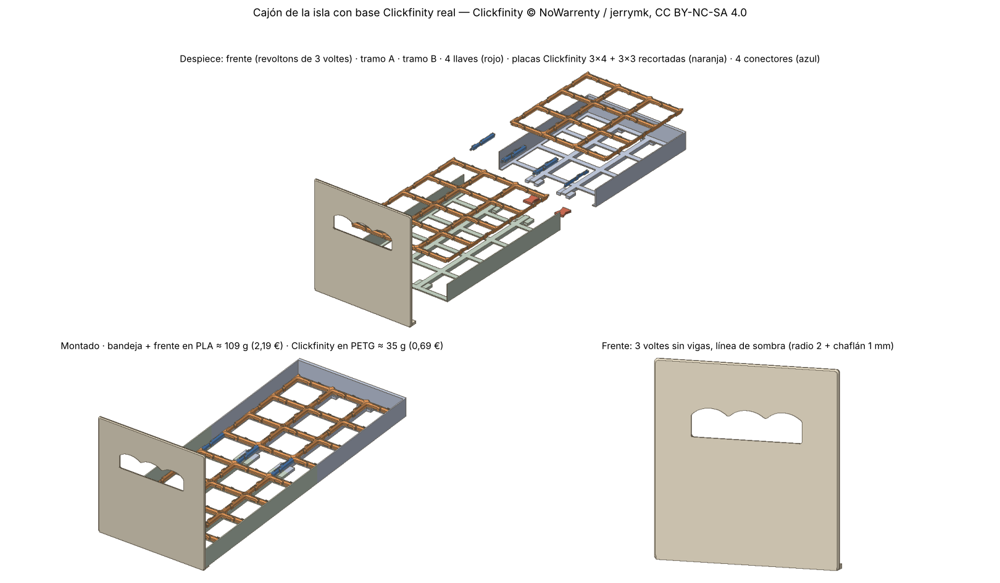

# Cajones para los huecos de la isla de la cocina

Huecos de la estantería (pensados para botellas de vino): **130 mm de ancho × 135 mm de alto**.

## Paso 1 — Marco de prueba de encaje (`marco_prueba_130x135.stl`)



Es el "marco de puerta" del cajón: solo el contorno exterior que tendría el cuerpo del cajón, con un poco de profundidad, para meterlo en el hueco y ver cómo encaja antes de imprimir el cajón entero.

| Parámetro | Valor | Por qué |
|---|---|---|
| Exterior | 129 × 134 mm | Hueco menos 0,5 mm de holgura por lado (1 mm en total) |
| Pared | 1,6 mm | 4 líneas con boquilla de 0,4: lo mínimo para que no se doble |
| Profundidad | 10 mm | Lo justo para que entre recto en el hueco y se pueda tocar |
| Escuadras interiores | 6 mm a 45° | Mantienen el marco a 90° y lo rigidizan sin apenas material |
| Chaflán en la base | 0,4 mm | Compensa la "pata de elefante" de la primera capa |
| Material | ≈ 9 cm³ ≈ 11 g de PLA | |

### Cómo imprimirlo

- Tumbado tal cual sale (10 mm de alto), **sin soportes**, sin balsa ni borde.
- Perímetros/paredes: 4 (así la pared es maciza y no hay relleno).
- Cabe en camas de 180 × 180 mm o más.

### Cómo leer la prueba

- **Entra y baila mucho** → bajar la holgura (`--holgura 0.3`).
- **Entra justo y desliza bien** → esa holgura es la buena para el cajón.
- **No entra o roza** → subir la holgura (`--holgura 0.8`) o medir el hueco en varios puntos (la madera no siempre es recta: mide arriba, en medio y abajo, y delante y al fondo).

## Regenerar con otras medidas

```bash
pip install manifold3d trimesh
python3 marco_prueba.py --holgura 0.8 --profundidad 15 --salida marco_h08.stl
python3 marco_prueba.py --help   # todos los parámetros
```

## Paso 2 — Cajón con base Clickfinity (v1 para imprimir)



**Piezas propias** (`stl/`, PLA):

| Pieza | Cantidad | Cómo imprimir |
|---|---|---|
| `frente_revoltons3.stl` | 1 | Boca abajo (la cara vista sobre la cama) |
| `tramo_A.stl` | 1 | Tal cual, patines contra la cama |
| `tramo_B.stl` | 1 | Tal cual |
| `llave_mariposa.stl` | 4 | Tal cual |

**Piezas Clickfinity** (el autor pide PETG; en PLA también sirven: con el tiempo los brazos pierden algo de agarre, pero la placa sigue centrando y sujetando los cubos como una base Gridfinity normal):

- Base: "Gridfinity Clickfinity Baseplate" de NoWarrenty (remix de las ClickPlates de jerrymk), licencia CC BY-NC-SA 4.0. No se incluyen aquí.
- Se generan desde el ZIP original con `python3 conceptos/cajon_click.py <ruta del zip>`, en `clickfinity_local/` (carpeta ignorada por git).
- Se recortan los medios nervios exteriores y las orejas laterales: sin recortar, una placa de 3 columnas mide 131,7 mm y el hueco mide 130 mm.

| Pieza | Cantidad |
|---|---|
| `placa_3x4_recortada.stl` | 1 |
| `placa_3x3_recortada.stl` | 1 |
| `conector_entero_a/b.stl` | 2 |
| `conector_exterior_izq/der_recortado.stl` | 1 + 1 |

Ajustes del autor para las piezas Clickfinity: boquilla de 0,4, 2 paredes, relleno del 15–30 %, 1 capa inferior y 2 superiores, y compensación de pata de elefante de 0,2 mm (en Bambu Studio, *Elephant foot compensation*). Antes, prueba a montar dos conectores con un trozo de placa: deben entrar con un "clic" a mano, sin martillo.

**Montaje**
1. Bandeja boca abajo: mete las 4 llaves en sus alojamientos (frente + tramo A, tramo A + tramo B).
2. Dale la vuelta y coloca la placa 3x4 delante y la 3x3 detrás.
3. Cierra la fila libre del medio con los 4 conectores.
